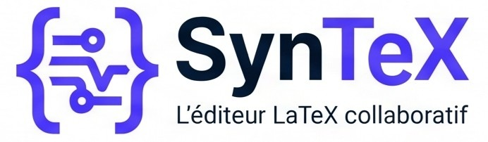

<p align="center">
  
</p>

# SynTeX — L'éditeur LaTeX collaboratif

Éditeur scientifique LaTeX moderne, conçu pour l'auto-hébergement ultra-léger sur homelab.

Contrairement à Overleaf qui exécute TeX Live sur le serveur (plusieurs Go de RAM), **toute la compilation (`pdfLaTeX`, `XeLaTeX`, `LuaLaTeX`, `bibtex8`, `Biber`, `SyncTeX`) tourne en WebAssembly dans un Web Worker du navigateur**. Le serveur Node 24 + SQLite natif consomme **~55–90 Mo de RAM** au repos comme en charge.

---

## Fonctionnalités (v1)

- **Authentification mono-compte durcie** : Zéro création de compte publique, mot de passe haché via `crypto.scrypt` + comparaison en temps constant `timingSafeEqual`, cookies `HttpOnly` / `SameSite=Lax` / `Secure` (auto derrière reverse-proxy HTTPS), protection CSRF et rate-limiting anti-brute-force compatible `X-Forwarded-For`.
- **Éditeur Split-Screen style Prism (CodeMirror 6)** :
  - Coloration syntaxique LaTeX & BibTeX, pliage de sections (`\section`) et d'environnements (`\begin{...}`).
  - Autocomplétion dynamique sur tout le projet : `\cite{...}` (clés `.bib`), `\ref{...}` / `\eqref{...}` (`\label`), `\input{...}`, `\includegraphics{...}` et auto-fermeture `\begin{...}`.
  - Raccourcis : `Ctrl+S` (sauvegarder), `Ctrl+Entrée` (compiler), `Ctrl+Shift+J` (SyncTeX vers le PDF).
- **Compilation WebAssembly & Viewer PDF.js** :
  - Moteur TeX Live 2026 WASM (`texlyre-busytex`) avec multi-fichiers, images binaires, `bibtex8`/`biber` et passes multiples automatiques.
  - Rendu `pdfjs-dist` haute définition conservant la position de scroll et le zoom à chaque recompilation.
  - Panneau de diagnostics parsant les erreurs/warnings LaTeX avec saut direct à la ligne fautive.
- **SyncTeX bidirectionnel** :
  - `Ctrl+Clic` (ou double-clic) sur le PDF → positionne le curseur sur la ligne `.tex` correspondante.
  - Bouton / raccourci SyncTeX dans l'éditeur → scrolle et met en surbrillance la ligne correspondante dans le PDF.
- **Recherche bibliographique intégrée (arXiv & Crossref)** :
  - Recherche en direct par titre, auteur, DOI ou identifiant arXiv, ajout sans doublon à `references.bib` et insertion de `\cite{cle}` en un clic.

---

## Démarrage rapide en développement (Windows / Linux / macOS)

Prérequis : **Node.js >= 22.5** (testé avec Node 24).

```bash
# 1. Installer les dépendances du monorepo
npm install

# 2. Télécharger une seule fois les binaires WebAssembly TeX Live (~BusyTeX dans apps/web/public/core)
npm run setup:wasm

# 3. Configurer tes identifiants locaux
cp .env.example .env

# (Optionnel) Générer un hash scrypt au lieu d'un mot de passe en clair :
npm run hash-password -- "MonSuperMotDePasse"

# 4. Lancer le backend (port 3000) et le frontend Vite (port 5173) dans deux terminaux :
npm run dev:server
npm run dev:web
```

Ouvre ensuite `http://localhost:5173`.

---

## Déploiement Homelab : Conteneur LXC Proxmox + FortiGate

### 1. Création du conteneur LXC sur ton NUC Proxmox
- **Template** : Debian 12 ou Ubuntu 24.04 (unprivileged container)
- **Ressources recommandées** : 1 vCPU, **512 Mo à 1 Go de RAM** (largement suffisant, le process Node utilise < 100 Mo), 4–8 Go de disque.

### 2. Installation automatique dans le LXC
Clone ce dépôt dans le conteneur LXC puis exécute :

```bash
chmod +x deploy/lxc/install-lxc.sh
sudo ./deploy/lxc/install-lxc.sh
```

Le script installe Node 24, télécharge les assets WASM BusyTeX (pour qu'ils soient hébergés localement par ton LXC sans dépendre d'Internet par la suite), compile le frontend + backend, te demande ton identifiant et ton mot de passe (stocké uniquement sous forme de hash `scrypt` dans `/etc/prism-latex/prism-latex.env`) et démarre le service `systemd` `prism-latex.service` sur le port `3000`.

### 3. Configuration Reverse-Proxy FortiGate
- Redirige le flux HTTPS externe vers `http://<IP_DU_LXC>:3000`.
- Active l'injection des en-têtes HTTP standards sur le Virtual Server / Web Proxy FortiGate :
  - `X-Forwarded-For` (utilisé par le rate-limiter anti-brute-force grâce à `TRUST_PROXY=true`)
  - `X-Forwarded-Proto: https` (active automatiquement l'attribut `Secure` sur le cookie de session `HttpOnly`)

---

## Feuille de route

- [x] **v1** : Éditeur split-screen CodeMirror 6, multi-fichiers, compilation WASM client-side, PDF.js + SyncTeX, citations arXiv/Crossref, auth mono-compte LXC.
- [ ] **v2** : Assistant IA contextuel (multi-provider / Ollama) avec suggestions et modifications en **diff inline** (`@codemirror/merge`) façon Prism.
- [ ] **v3** : Collaboration temps réel multi-utilisateurs via CRDT **Yjs** (`y-codemirror.next` + WebSocket léger).
